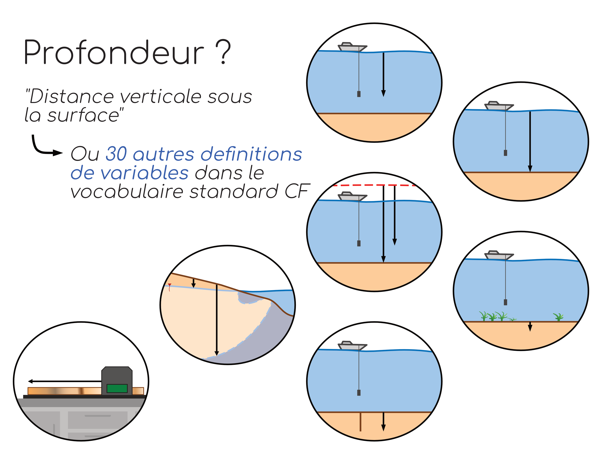

# Dictionnaire de variables

## Pourquoi un dictionnaire ?

Afin de faciliter la réutilisation, utilisation  et l'interopérabilité des données, il est important d'utiliser un vocabulaire commun pour désigner les différentes variables. Certains standards ont été conçus à cet effet tels que le vocabulaire de la [Convention CF](https://cfconventions.org/) pour les données océanographiques de physico-chimie, ou encore le vocabulaire issu du [Darwin Core](https://dwc.tdwg.org/list/) pour les données de biologie et de biodiversité. Ces vocabulaires contrôlés assignent à des termes uniques une variable précise. Ainsi par exemple, en dehors de tout standard, une simple variable _profondeur_ pourrait être interprétée de très nombreuses manières (figure ci-dessous). Dans la convention CF par contre, _depth_ sera spécifiquement défini par la "distance verticale sous la surface" et d'autres variables telles que *sea_floor_depth* désignera précisément la profondeur du fond marin depuis la surface de l'eau. 

Bien que l'utilisation dès le départ d'un vocabulaire contrôlé soit fortement recommandée, dans certains cas les termes associés aux différentes variables peuvent ne pas sembler intuitifs et ne sont pas forcément pratiques à utiliser sur le terrain ou au moment des analyses. Il est donc important de toujours construire et associer un dictionnaire de variables aux bases de données en elles-mêmes. Ce dictionnaire contiendra le plus de métadonnées possible associées à chaque variable de manière à maximiser les chances que les données soient interprétées correctement. Par exemple, pour des variables de *profondeurs* les informations du dictionnaire pourraient être :  
**profondeur_r**  
    - unité : *mètres*  
    - description : *profondeur depuis le fond marin de l'extrémité maximale à laquelle s'enfonce les racines des végétaux benthiques*  
    - méthode : *observation visuelle*  
**profondeur_b**  
    - unité : *mètres*  
    - description : *profondeur du fond marin depuis la surface de la *mer*  
    - méthode : *sonde de pression au niveau du fond marin dont les mesures sont converties en distance  

> 💡 **Pas de panique :**  Les standards et les vocabulaires contrôlés évoluent au fur et à mesure que la recherche avance et que l'effort de diffusion des données s'intensifie. Ce domaine constitue en soi une discipline scientifique à part entière. Les scientifiques de données sont là pour effectuer et/ou raffiner le processus de standardisation de vos données. L'important est que toute l'information soit disponible pour comprendre ce que représente la donnée.  

## Que contient un dictionnaire de variables ?

### Liste des variables et descriptions
Le dictionnaire de variable doit contenir l'ensemble des variables partagées, y compris celles qui pourraient vous sembler évidentes. On décrira ainsi :  

- leurs noms abrégés (tels que présentés dans les données) ;  
- leurs noms complets (tels qu'on le lirait dans la littérature) ;  
- leurs noms standard (dans l'idéal, mais **pas obligatoire à l'état d'ébauche** ou de document de travail) ;  
- leurs unités de mesure ;  
- leurs définitions et/ou descriptions précises.  

### Système de coordonnées de référence
Dans le cas de données spatialisées (c'est-à-dire incluant une information sur leur localisation précise dans l'espace), il est **impératif de préciser dans la description de la variable le système de coordonnées géographique de référence** (abrégé *SRC* en français et *CRS* en anglais) associé aux coordonnées fournies.  
Le système le plus courant dans le cadre d'une diffusion des données est le système WGS84 (EPSG:4326). Pour les données enregistrées dans des SRC incluant un zonage, il faut indiquer à la fois le système et la zone considérée. Par exemple en Amérique du Nord, le système NAD83 est couramment utilisé, mais considère différentes zones. Une manière de simplifier la notation pour s'assurer d'être le plus compréhensible possible est de référencer le système de coordonnées en lui ajoutant le code epsg qui lui correspond. Les descriptions des différents systèmes de coordonnées sont disponibles sur le site : [https://epsg.io/](https://epsg.io/)  

### Le temps  
Les bonnes pratiques suggèrent que le temps soient toujours indiqués dans le *temps universel coordonné* UTC selon la norme ISO8601 (cf. [section *Dates et heures*](http://10.0.2.5:8880/guide/recommendations/#21-dates-et-heures) du guide détaillé). Cependant, il est parfois nécessaire que les heures soient indiquées en heure locale dans la base de données. Ainsi, il sera très important de préciser dans le dictionnaire si le temps fourni est indiqué en *UTC*, en *heures standards suivant strictement le fuseau horaire*, ou en *heures locales* pouvant être sujette à une modification saisonnière. 
Par exemple à Rimouski (Qc), le 08 juillet 2024 à **14h00** en temps UTC est équivalent au 08 juillet 2024 à **09h00** en temps standard de l'Est (EST) mais aussi au 08 juillet 2024 à **10h00** en temps local. Pour cette raison, l'utilisation du format *2024-07-08T14:00:00Z*, *2024-07-08T09:00:00-05:00*, ou *2024-07-08T10:00:00-04:00* directement dans la base de données est également fortement recommandée.  

### Instruments impliqués
Afin d'assurer une transparence maximale et de s'assurer que des données décrivant une même variable soient comparables entre elles, il peut être pertinent d'indiquer les instruments qui ont permis de les obtenir. On pourra indiquer ainsi les instruments ayant servi à l'**échantillonnage** et les instruments ayant servi aux **analyses**. Dans la mesure du possible, les informations pertinentes minimales sont :  

- le type d'instrument *(ex : rosette CTD ; sonde multiparamétrique ; salinomètre)* ;  
- la marque de l'instrument ;  
- le modèle de l'instrument.  

### Définition de la méthode
De la même manière que pour les instruments, la méthode qui a servi à obtenir les données peut servir à déterminer si des données sont comparables entre elles. Une courte **description des grandes étapes de l'analyse** telles que des filtrations, des ajouts de solutions pour la conservation d'un échantillon ou pour l'extraction d'un composé sont des éléments importants à ajouter à la définition des variables.  

## Où placer le dictionnaire ?
Un dictionnaire de variable peut être vu comme une sorte de *clé de lecture* permettant de déchiffrer, et donc de comprendre, une base de données. **Il est donc essentiel que le dictionnaire soit en tout temps attaché à sa base de données**. Pour ce faire, différentes stratégies sont possibles.  

### Fichier combinant données et métadonnées  
La stratégie la plus sécuritaire est de choisir un format de fichier qui contient à la fois les données et les métadonnées (dont les informations du dictionnaire) au sein d'un unique fichier. De cette manière, il n'y a pas de risques que les informations soient séparées lors du transfert de la base de données. C'est le cas par exemple pour des fichiers du type netCDF. Cette solution n'est cependant pas pratique pour des bases de données en construction où il faudrait revenir souvent ajouter ou modifier le contenu.  
Souvent cette stratégie est mise en place lorsque la construction de la base de données est terminée et que l'on souhaite partager la base de données. 

### Tables indépendantes partagées ensembles
Pour faciliter ce travail d'édition, une solution commune est de construire ce dictionnaire dans une table en parallèle de vos bases de données, soit dans un fichier csv à part, soit en tant qu'onglet inclus dans un fichier du type *Excel* (*rappelons cependant ici que les bonnes pratiques veulent que le partage de données se fasse au travers de fichier non propriétaire*). Cette manière de faire implique cependant de bien **s'assurer que le fichier *Dictionnaire* accompagne toujours le fichier de base de données**. L'utilisation d'un dossier d'archive *.zip* peut-être considérée pour s'assurer que les fichiers ne soient pas séparés.  
Dans le cas où plusieurs bases de données seraient construites en parallèle avec un fichier de dictionnaire unique, il sera important d'ajouter le nom de la base de données où sont localisées les variables décrites.  

## Exemple de structure d'un dictionnaire

| file_name | variable  | long_name | standard_name | unit | description | instruments | methode |
| :-------- | :-------- | :-------- | :------------ | :--- | :---------- | :---------- | :------ |
| CTD_profils_2024-05-05.csv | OXY | Oxygen concentration | mass_concentration_of_oxygen_in_sea_water | mg m-3 | Oxygen concentration in the water colomn | Oxygen probe on CTD - SeaBird - SBE43 | Direct measurments with post-calibration against laboratory analysis |
| CTD_profils_2024-05-05.csv | lat | latitude | latitude | degrees_north | WGS84 - epsg:4326; 5m precision | GPS - BRAND - MODEL | On the boat at the start of each profil |
| CTD_profils_2024-05-05.csv | ... | ... | ... | ... | ... | ... | ... |    
